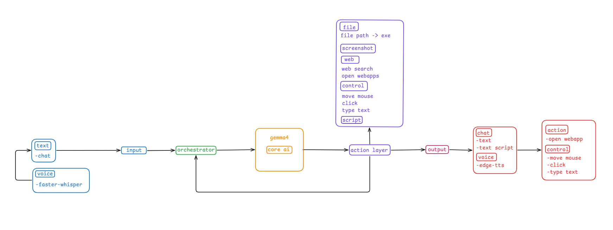

# Desktop AI Agent

**Demo v0.2.0** — a local multimodal desktop assistant.

You talk or type. A local **Gemma 4** model (via [Ollama](https://ollama.com)) decides what to do. A gated **action layer** runs only approved tools (open apps, web search/open, screenshot, UI click/type, wait, or show a script). Replies come back as text and optional speech.

```text
text / voice  →  input  →  orchestrator  →  gemma4 (core)  →  action layer  →  chat / voice
                                ↑___________________________________|
```



## What this demo includes

| Area | In v0.2.0 |
|------|-----------|
| **Chat** | Always-on-top top-edge bar (hover to expand; context meter; Stop / New chat / Config) |
| **Voice in** | Mic push-to-talk + wake word (“hey Zsuzsi” / variants) via faster-whisper |
| **Core AI** | Ollama + `gemma4` / `gemma4-agent`, tool calling, folder index (apps + AppX) |
| **Actions** | `open_app`, `web_search`, `web_open`, `screenshot`, `wait`, `list_elements`, `move_mouse`, `click`, `type_text`, `provide_script` (display only) |
| **Voice out** | TTS via edge-tts (or offline SAPI) |
| **Safety** | Registry + executor gate; high-risk actions denied until confirm UI exists |
| **Deps** | Runtime packages install **automatically on every start** |

Not in this demo yet: full browser automation, camera gestures, free `exec` of model code.

## Quick start

### Prerequisites

- Windows 10/11
- Python **3.10+**
- [Ollama](https://ollama.com) installed and on `PATH`

### Run

From the project root:

```powershell
python -m app
```

Or double-click / run:

```powershell
scripts\start.bat
```

**Every launch** pip-installs / refreshes runtime dependencies first (`bootstrap_deps`), then the UI will:

1. Detect monitors and enable DPI awareness  
2. Index usable application `.exe` / AppX launchers on drives C/D/E  
3. Start Ollama and pull / build models if needed  
4. Show the top-edge chat bar  

Hover the nub at the top of the screen, then try `open steam`, `what do you see on my screen?`, or `click the Start button`.

Dev tests only (not auto-installed):

```powershell
pip install -e ".[dev]"
pytest
```

Voice / TTS / screenshot / UI Automation packages are part of the startup install — no separate `pip install -e ".[voice]"` step for the mentor demo.

## Architecture (scanned from `src/desktop_ai_agent`)

| Layer | Role | Key modules |
|-------|------|-------------|
| **Bootstrap** | Install runtime deps every start | `bootstrap_deps.py` |
| **Input** | Text + optional STT / wake | `input/voice.py`, `input/ui_elements.py` |
| **Orchestrator** | Agent loop; never touches the OS | `orchestrator/agent_loop.py`, `service.py`, `prompts.py`, `task_state.py` |
| **Core AI** | Ollama chat, models, app catalog | `core/session_setup.py`, `chat_client.py`, `ollama_service.py`, `folder_index/` |
| **Action** | Validate → risk gate → run → audit | `action/registry.py`, `executor.py`, `handlers.py`, `tools/` |
| **Output** | Optional speech | `output/tts.py` |
| **UI** | Setup window + OverlayBar | `ui/launcher.py`, `overlay_bar.py`, `chat_text.py` |

### Orchestrator behaviour worth knowing

- **Stop limits:** max **20** rounds / task; **2** consecutive failed rounds; user **Stop**
- **Plan size:** executor accepts at most **10** steps per plan
- **Vision heuristic:** auto-screenshot when the message looks like screen Q&A; deferred capture after “open X and see…”
- **Follow-ups:** after `click` / `type_text`, auto `list_elements(active)` so the model can continue
- **Nudge:** if the model promises an action in prose without a tool call, one corrective nudge
- **Leaked calls:** recovers Gemma `call:name{…}` text into real tool calls when needed
- **Handoff / compaction:** at ~**85%** of the 8k context (`CONTEXT_TOKENS = 8192`), up to **3** handoffs
- **UI control flow:** `list_elements` → `move_mouse` / `click` / `type_text` (list cleared after click/type)

### Actions (registry risk)

| Action | Risk | Notes |
|--------|------|--------|
| `screenshot` | low | `primary` / `all` / `monitor` / `region`; agent windows excluded from capture |
| `wait` | low | 0–30 s |
| `web_search` | low | DuckDuckGo snippets via `ddgs` |
| `list_elements` | low | active / taskbar / desktop / all (max ~60; list valid ~60s) |
| `provide_script` | low | display-only JSON; **ends turn**; never executed |
| `open_app` | medium | indexed launchers only; no launch args |
| `web_open` | medium | `http` / `https` only |
| `move_mouse` | medium | by element number (model never sends raw coords) |
| `click` | medium | left/right, optional double; rate-limited; corner emergency stop |
| `type_text` | medium | paste into inputs; no Enter; no passwords; risky-name gate |

## Project layout

```text
desktop_ai_agent/
├── app/                         # python -m app bootstrap
├── src/desktop_ai_agent/
│   ├── bootstrap_deps.py        # pip install on every start
│   ├── input/                   # voice STT + UI Automation helpers
│   ├── core/                    # Ollama, session, folder index, chat
│   ├── orchestrator/            # agent loop + UI service
│   ├── action/                  # registry, executor, handlers, tools
│   ├── output/                  # TTS
│   └── ui/                      # setup launcher + OverlayBar
├── config/                      # setup.json, Modelfile, index output
├── docs/                        # single PDF documentation
├── scripts/                     # start.bat / start.ps1 / generate_docs_pdf.py
├── tests/
└── pyproject.toml
```

## Documentation

One PDF (mentor preference — not a folder of markdown files):

- [`docs/Demo_v0.2.0.pdf`](docs/Demo_v0.2.0.pdf) — industrial technical specification (architecture, actions, config, ops)

Regenerate after doc changes:

```powershell
python scripts/generate_docs_pdf.py
```

## Configuration

Main knobs live in [`config/setup.json`](config/setup.json):

- `ollama` — models, host, timeout  
- `folder_index` — drives and app scan flags  
- `ui` — setup window + chat bar geometry / auto-hide  
- `voice` / `voice.wake_word` — STT + wake phrases  
- `output.tts` — engine (`edge` / `sapi`), voice, wake ack  

## Logs

`logs/` is gitignored (relative to the working directory):

- `logs/audit.jsonl` — `rejected` / `declined` / `execute` / `result`
- `logs/screenshots/` — timestamped PNGs

## License / status

Demo release **0.2.0**. Expect rough edges with a small local model; check `logs/audit.jsonl` when something looks wrong.
