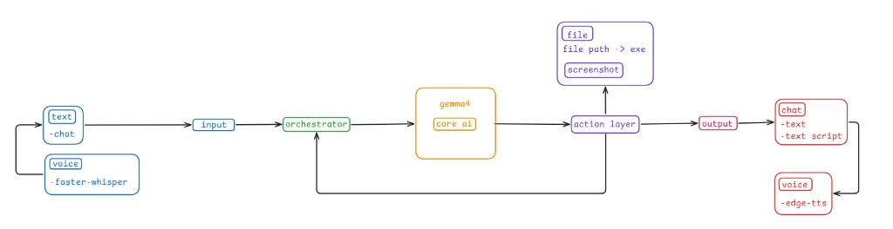

# Architecture

Desktop AI Agent is a **local multimodal assistant**. Input becomes a task, the core model plans tool calls, the action layer runs only allowed tools, and output goes back as chat text and optional speech.



## Pipeline

```text
Input → Orchestrator → Core AI (gemma4) → Action Layer → Output
                ↑___________________________|
```

| Layer | Role | Tech in v0.1.0 |
|-------|------|----------------|
| **Input** | Collect user intent | Typed chat; voice via faster-whisper (PTT + wake word) |
| **Orchestrator** | Run the agent loop; never touches the OS | `agent_loop`, `AgentService`, system prompt |
| **Core AI** | Understand the task; emit tool calls or text | Ollama + gemma4; Program Files index |
| **Action layer** | Validate and execute tools; feed results back | Registry → executor → handlers |
| **Output** | Show / speak the result | Top-edge chat bar (last me/ai); optional edge-tts / SAPI |

The arrow from **action layer → orchestrator** is the self-correction loop: after each tool result (or rejection), the model gets another turn until the task is done or a stop limit hits.

## Layer details

### Input

- **Text:** chat box in the launcher UI.
- **Voice:** optional Mic button (push-to-talk) or continuous wake-word listening.
- Both paths end as a normal text task for the orchestrator.

Vision from a webcam or gestures is **planned**, not in the demo. Screen vision today means an action-layer **screenshot** attached to the next model turn.

### Orchestrator

- Builds the prompt and tool list from the action registry.
- Calls the model, turns tool calls into a plan, sends the plan to the executor.
- Stops on: plain-text answer, `ends_turn` action (`provide_script`), decline, too many failures, or max rounds (8).
- Does **not** import handlers or run OS commands itself.

### Core AI

- Local LLM behind Ollama (`gemma4`).
- Sees only tools that exist in the registry.
- Uses the Program Files catalog when opening apps by name.
- If no tool fits, it asks whether you want a **display-only** Python script (`provide_script`).

See [core.md](core.md).

### Action layer

- **Registry:** names, parameters, risk levels (source of truth).
- **Executor:** validates args, enforces risk, logs, then runs.
- **Handlers:** do the work (`open_app`, `screenshot`, `wait`, `provide_script`).

See [action.md](action.md).

### Output

- Always: text in the UI (and script JSON when `provide_script` is used).
- Optional: TTS for wake ack, final replies, and errors.

## Demo vs later

| In demo v0.1.0 | Later |
|----------------|--------|
| Chat + voice STT | Camera / gesture input |
| Tool calling + gated actions | Mouse / keyboard automation |
| Screenshot for screen Q&A | Richer vision pipeline |
| Display-only scripts | Confirmed high-risk actions + safer code runner |

## Code map

```text
src/desktop_ai_agent/
  input/voice.py          # STT
  orchestrator/           # loop + service + prompts
  core/                   # Ollama, session, chat, folder_index
  action/                 # registry, executor, handlers, tools
  output/tts.py           # speaker
  ui/launcher.py          # setup UI
  ui/overlay_bar.py       # always-on-top top-edge chat bar
```
